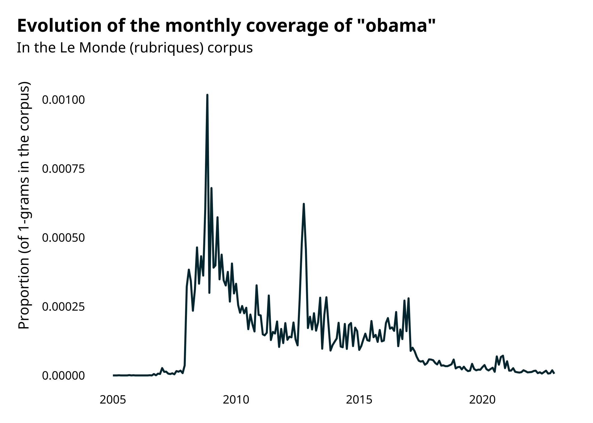

<!-- README.md is generated from README.Rmd. Please edit that file -->

# rallicagram

<!-- badges: start -->

<!-- badges: end -->

## Overview

`rallicagram` is a R wrapper for the
[Gallicagram](https://www.gallicagram.com/) API.

[Gallicagram](https://www.gallicagram.com/) is a super nice tool and set
of databases that enables to easily run simple Natural Language
Processing (**NLP**) analyses on a wide set of corpora. In particular,
it enables to build historical **time series of occurrences of
keywords** in various media in one line of code.

## Installation

You can install the development version of rallicagram from
[GitHub](https://github.com/vincentbagilet/rallicagram) with:

``` r
# install.packages("pak")
pak::pak("vincentbagilet/rallicagram")
```

## Usage

The main function, `gallicagram`, builds a data frame with the yearly,
monthly or daily proportion of mentions of a term.

``` r
library(rallicagram)

gallicagram(keyword = "président", corpus = "lemonde", from = 1960)
#> # A tibble: 756 × 10
#>    date       keyword   n_occur n_total prop_occur  year month corpus resolution
#>    <date>     <chr>       <int>   <int>      <dbl> <int> <int> <chr>  <chr>     
#>  1 1960-01-01 président    1338  872943    0.00153  1960     1 lemon… monthly   
#>  2 1960-02-01 président    1360  915672    0.00149  1960     2 lemon… monthly   
#>  3 1960-03-01 président    1461  928764    0.00157  1960     3 lemon… monthly   
#>  4 1960-04-01 président    1239  772707    0.00160  1960     4 lemon… monthly   
#>  5 1960-05-01 président    1355  835612    0.00162  1960     5 lemon… monthly   
#>  6 1960-06-01 président    1314  850245    0.00155  1960     6 lemon… monthly   
#>  7 1960-07-01 président    1189  942062    0.00126  1960     7 lemon… monthly   
#>  8 1960-08-01 président     979  739018    0.00132  1960     8 lemon… monthly   
#>  9 1960-09-01 président    1506  904804    0.00166  1960     9 lemon… monthly   
#> 10 1960-10-01 président    1107  826661    0.00134  1960    10 lemon… monthly   
#> # ℹ 746 more rows
#> # ℹ 1 more variable: n_of <chr>
```

It enables to draw nice graphs representing the evolution of the use of
a term in time, in two lines of code.



The package also allows to describe co-occurrences or words associated
with a keyword. The corresponding functions are described in the
[vignette](articles/rallicagram.html).

## Corpora

The corpora available via Gallicagram are the following. Note, for now,
there are two “Le Monde” corpora, with different functions associated
with each (this is a feature of the data base and will evolve shortly).

| Corpus Name | Corpus | Reliable From | Reliable To | Max Length | Resolution | Number Of Words | Available Functions |
|:---|:---|---:|---:|---:|:---|:---|:---|
| Le Monde (rubriques) | lemonde | 1945 | 2024 | 3 | monthly | 1.5e+09 | article\|cooccurr_article\|associated_article\|with\|associated |
| Presse de Gallica | presse | 1789 | 1950 | 3 | monthly | 5.7e+10 | cooccurr\|with\|associated |
| Livres de Gallica | livres | 1700 | 1940 | 5 | yearly | 1.6e+10 | cooccurr\|with\|associated |
| Presse + livres de Gallica | presse_livres | 1789 | 1940 | 3 | yearly | 7.3e+10 | \- |
| Deutsches Zeitungsportal (DDB) | ddb | 1780 | 1950 | 2 | monthly | 3.9e+10 | with\|associated |
| American Stories | american_stories | 1798 | 1963 | 3 | yearly | 2e+10 | with\|associated |
| The Guardian | guardian | 1999 | 2026 | 2 | daily | 2e+09 | with\|associated |
| Journal de Paris | paris | 1777 | 1827 | 2 | daily | 8.6e+07 | cooccurr\|with\|associated |
| Moniteur Universel | moniteur | 1789 | 1869 | 2 | daily | 5.11e+08 | cooccurr\|with\|associated |
| Journal des Débats | journal_des_debats | 1789 | 1944 | 1 | daily | 1.2e+09 | cooccurr |
| La Presse | la_presse | 1836 | 1869 | 2 | daily | 2.53e+08 | cooccurr |
| Le Constitutionnel | constitutionnel | 1821 | 1913 | 2 | daily | 6.4e+07 | cooccurr |
| Le Figaro | figaro | 1854 | 1952 | 2 | daily | 8.7e+08 | cooccurr\|with\|associated |
| Le Temps | temps | 1861 | 1942 | 2 | daily | 1e+09 | cooccurr\|with\|associated |
| Le Petit Journal | petit_journal | 1863 | 1942 | 2 | daily | 7.45e+08 | cooccurr\|with\|associated |
| Journal officiel | journal_officiel | 1869 | 1952 | 1 | daily | 8.42e+08 | cooccurr |
| Le Petit Parisien | petit_parisien | 1876 | 1944 | 2 | daily | 6.31e+08 | cooccurr\|with\|associated |
| L’Humanité | huma | 1904 | 1952 | 2 | daily | 3.18e+08 | cooccurr\|with\|associated |
| Opensubtitles (français) | subtitles | 1935 | 2020 | 3 | yearly | 1.7e+07 | with\|associated |
| Opensubtitles (anglais) | subtitles_en | 1930 | 2020 | 3 | yearly | 1.02e+08 | with\|associated |
| Rap français (Genius) | rap | 1995 | 2024 | 5 | yearly | 2e+07 | with\|associated |
| Persée | persee | 1930 | 2023 | 2 | yearly | 1e+09 | with\|associated |
| Cairn | route à part (query_cairn) | 2001 | 2025 | 3 | yearly | \- | with\|associated |
| Persée + Cairn | route à part (persee+cairn) | 1930 | 2025 | 2 | yearly | \- | \- |
| BFM TV (transcriptions) | tv_bfmtv | 2026 | 2026 | 3 | daily | \- | with\|associated |
| CNews (transcriptions) | tv_cnews | 2026 | 2026 | 3 | daily | \- | with\|associated |
| France Info (transcriptions) | tv_franceinfo | 2026 | 2026 | 3 | daily | \- | with\|associated |
| Ouest-France (Gallica) | ouest | 1899 | 2025 | 2 | yearly | \- | \- |
| Prénoms INSEE | prenoms | 1900 | 2024 | 1 | yearly | \- | \- |
| Journal officiel (JORF) | jorf | 1990 | 2026 | 2 | monthly | 5.9e+08 | with\|associated |
| Libération | libe | 1998 | 2025 | 3 | daily | \- | with\|associated |
| \# Majinbook français | majinbook | 1700 | 2023 | 4 | yearly | \- | with\|associated |
| \# Majinbook espagnol | spa_majinbook | 1700 | 2023 | 4 | yearly | \- | with\|associated |
| \# Majinbook anglais | eng_majinbook | 1700 | 2023 | 2 | yearly | \- | with\|associated |
| \# Majinbook allemand | deu_majinbook | 1700 | 2023 | 4 | yearly | \- | with\|associated |
| Presse contemporaine (toutes) | presse_moderne | 2008 | 2026 | 2 | daily | \- | \- |
| 20 Minutes | 20minutes | 2006 | 2026 | 2 | daily | \- | with\|associated |
| BFM TV | bfmtv | 2012 | 2026 | 2 | daily | \- | with\|associated |
| Challenges | challenges | 2006 | 2026 | 2 | daily | \- | with\|associated |
| CNews | cnews | 2012 | 2026 | 2 | daily | \- | with\|associated |
| France Soir | francesoir | 2015 | 2026 | 2 | daily | \- | with\|associated |
| Gala | gala | 2008 | 2026 | 2 | daily | \- | with\|associated |
| L’Opinion | l_opinion | 2013 | 2026 | 2 | daily | \- | with\|associated |
| La Croix | lacroix | 1995 | 2024 | 3 | monthly | \- | with\|associated |
| La Dépêche | la_depeche | 2012 | 2026 | 2 | daily | \- | with\|associated |
| La Provence | laprovence | 2014 | 2026 | 2 | daily | \- | with\|associated |
| La Tribune | latribune | 2015 | 2026 | 2 | daily | \- | with\|associated |
| Le Capital | le_capital | 2009 | 2026 | 2 | daily | \- | with\|associated |
| Le Courrier de l’Ouest | le_courrier_de_l_ouest | 2019 | 2026 | 2 | daily | \- | with\|associated |
| Le Figaro (web) | le_figaro | 2006 | 2026 | 2 | daily | \- | with\|associated |
| Le Journal du Dimanche | le_journal_du_dimanche | 2008 | 2026 | 2 | daily | \- | with\|associated |
| Le Maine Libre | le_maine_libre | 2019 | 2026 | 2 | daily | \- | with\|associated |
| Le Marin | le_marin | 2013 | 2026 | 2 | daily | \- | with\|associated |
| Le Monde | le_monde | 1945 | 2026 | 2 | daily | \- | with\|associated |
| Le Nouvel Observateur | le_nouvel_observateur | 2010 | 2026 | 2 | daily | \- | with\|associated |
| Le Télégramme | le_telegramme | 2009 | 2011 | 2 | daily | \- | with\|associated |
| Le Parisien | leparisien | 2001 | 2024 | 2 | monthly | \- | with\|associated |
| Les Échos | les_echos | 1991 | 2026 | 2 | daily | \- | with\|associated |
| Marianne | marianne | 2019 | 2026 | 2 | daily | \- | with\|associated |
| Mediapart | mediapart | 2008 | 2026 | 2 | daily | \- | with\|associated |
| Midi Libre | midilibre | 2011 | 2026 | 2 | daily | \- | with\|associated |
| Nice-Matin | nice_matin | 2015 | 2026 | 2 | daily | \- | with\|associated |
| Ouest-France | ouest_france | 2012 | 2026 | 2 | daily | \- | with\|associated |
| Paris Match | paris_match | 2009 | 2026 | 2 | daily | \- | with\|associated |
| Paris Normandie | paris_normandie | 2021 | 2026 | 2 | daily | \- | with\|associated |
| Presse Océan | presse_ocean | 2019 | 2026 | 2 | daily | \- | with\|associated |
| Sud Ouest | sud_ouest | 2010 | 2017 | 2 | daily | \- | with\|associated |
| Télérama | telerama | 2008 | 2026 | 2 | daily | \- | with\|associated |
| Valeurs Actuelles | valeurs_actuelles | 2008 | 2025 | 2 | daily | \- | with\|associated |
| Voici | voici | 2018 | 2026 | 2 | daily | \- | with\|associated |
| Voiles et Voiliers | voiles_et_voiliers | 2009 | 2026 | 2 | daily | \- | with\|associated |

Additional information on Gallicagram can be found on a
[preprint](https://osf.io/preprints/socarxiv/84bf3/) by Gallicagram
developers [Benoît de Courson](https://regicid.github.io/) and Benjamin
Azoulay and on the “Notice” tab of the [Gallicagram
website](https://www.gallicagram.com/).
